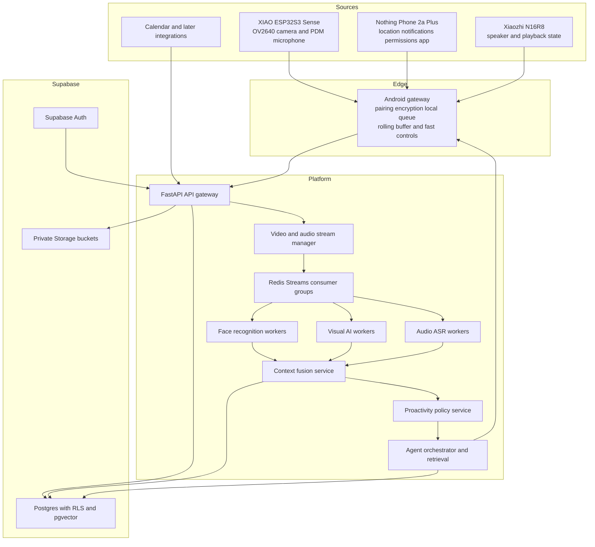
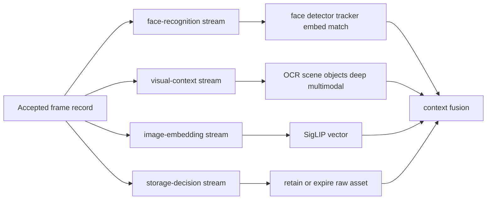
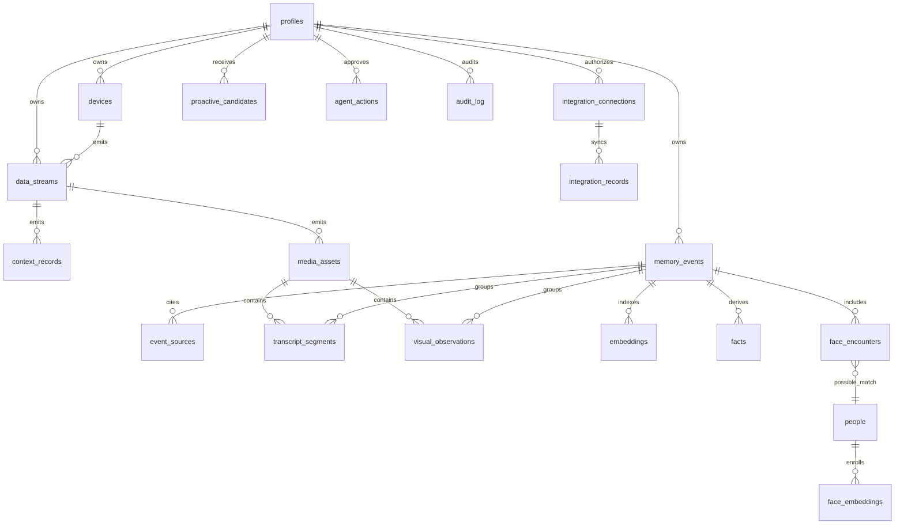
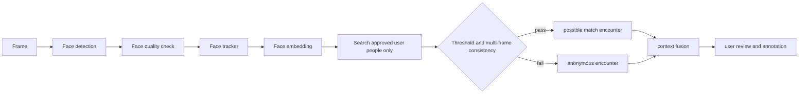
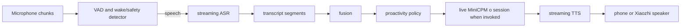
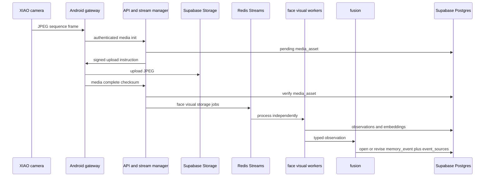
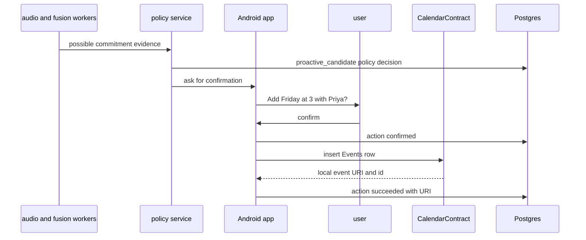
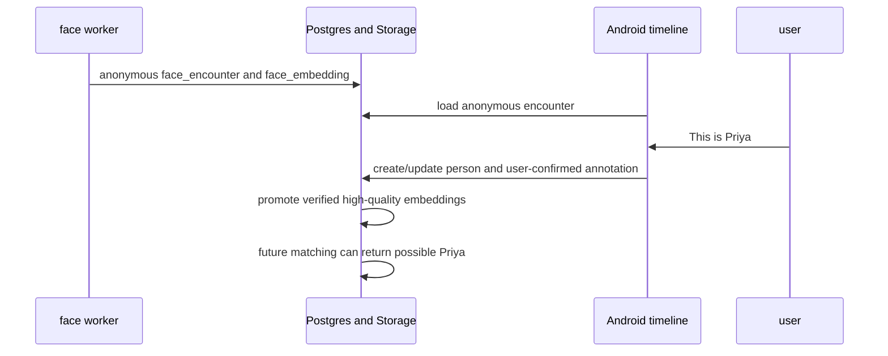

# Personal AI Engineering and Product Manual

## 0. Authority, scope, and operating rules

This is the canonical build specification for the product. It supersedes the prototype architecture in this repository. Autonomous agents must follow this document before changing code. The product is a private, proactive, multimodal personal context assistant. It captures user-approved continuous audio, camera frames, phone location, notification context, and calendar context; converts them into timestamped evidence; fuses that evidence into a personal timeline; and proactively assists only under an explicit policy.

The product must not be implemented as an uncontrolled surveillance recorder. It must have a physical capture pause, visible capture status, per-source consent, retention controls, user deletion/export, evidence-linked answers, confirmation for external actions, and strict tenant isolation.

### 0.1 Mandatory invariants

1. Every source record has `occurred_at`, `received_at`, and `created_at` timestamps.
2. `occurred_at`, not arrival order, controls context fusion.
3. Every user-owned row has `user_id` and Supabase Row Level Security (RLS).
4. Raw audio/video/image bytes are stored in Supabase Storage, never Postgres columns.
5. A source observation is immutable. Derived facts and fused events are versioned, never silently overwritten.
6. Every agent answer, proactive prompt, and action must retain source-event evidence links.
7. The AI model may draft a proactive prompt but cannot bypass the deterministic policy engine.
8. External side effects, including CalendarContract writes, require user confirmation unless a separately configured, explicitly accepted automation rule authorizes the exact action.
9. Face recognition is a dedicated biometric pipeline; the conversational AI only receives its controlled result, confidence, and evidence references.
10. Unknown faces are anonymous encounters, not automatically named identities.

### 0.2 Technology decisions

| Area | Required technology |
|---|---|
| Canonical data store | Supabase Postgres |
| Raw media | Supabase Storage private buckets |
| Authentication | Supabase Auth with JWTs; device tokens minted by backend after pairing |
| Vector search | Postgres `pgvector` in Supabase |
| API | Python 3.11, FastAPI, Pydantic v2 |
| Async work queue | Redis Streams with consumer groups |
| Android | Kotlin, Jetpack Compose, WorkManager, Room with SQLCipher, Android 14 minimum target behavior |
| Firmware | PlatformIO, Arduino framework, ESP32-S3 |
| Real-time multimodal voice candidate | MiniCPM-o, deployed behind the model adapter contract |
| Visual retrieval | SigLIP embedding service |
| Face pipeline | detector + tracker + ArcFace-style face embedding matcher |
| Speech | streaming ASR worker and streaming TTS worker, both behind provider adapters |
| Infrastructure | Docker Compose for development; containerized services for production |
| CI | GitHub Actions compatible workflow files; no secrets committed |

## 1. Product Requirements Document

### 1.1 Executive summary

The product is an always-available personal AI assistant delivered through AI glasses, a phone application, and an optional speaker endpoint. The assistant turns continuous, user-approved multimodal context into private, evidence-backed personal memory. It helps users remember commitments, people, locations, conversations, notifications, and routines. It can ask timely questions such as “You agreed to Friday at 3. Add it to your calendar?” without requiring the user to remember to ask first.

The phone is the primary gateway and control surface. The Seeed Studio XIAO ESP32S3 Sense is a capture endpoint. The Xiaozhi N16R8 board is an output-only speaker endpoint. The server performs durable ingestion, stream management, AI work, context fusion, storage, retrieval, and proactivity evaluation.

### 1.2 Success metrics

| Metric | Launch target | Measurement |
|---|---:|---|
| Authenticated source ingestion acceptance | 99.5% | accepted envelopes / attempted envelopes per day |
| Lost source data after acknowledged upload | 0 | checksum and sequence reconciliation |
| P95 location context ingest latency | <= 2 seconds | `received_at - occurred_at` for online phone samples |
| P95 first partial transcript latency | <= 2 seconds | server ASR partial emission after audio chunk close |
| P95 proactive candidate evaluation | <= 5 seconds | event stabilization to policy decision |
| Calendar action correctness | 100% confirmed actions | action ledger reconciled against CalendarContract URI |
| Cross-tenant data access | 0 | RLS negative integration tests |
| Evidence coverage for agent answers | 100% | answer has >=1 source event reference |
| User-dismissed proactive prompts | <= 35% after onboarding | prompt interaction metrics |
| User ability to pause capture | <= 1 second locally | device/app instrumented test |

### 1.3 Personas

| Persona | Primary need | Product value |
|---|---|---|
| Busy professional | Recall names, commitments, meetings, and follow-ups | An evidence-backed second memory and calendar companion |
| Older adult | Orientation, reminders, and gentle help | Simple answers grounded in the user’s recent life, not medical diagnosis |
| Caregiver-approved user | Configurable support and shared safety plan | Explicitly scoped assistance and optional caregiver access |
| Privacy-conscious wearer | Control and deletion | Visible sensing, pause control, retention limits, and auditability |

### 1.4 User stories and acceptance criteria

#### US-001 Continuous context capture

**Given** the user has signed in, paired an approved device, and capture is enabled, **when** the camera, microphone, or phone emits a valid event, **then** the server stores a source record with device identity, stream identity, source time, receipt time, privacy level, and checksum/reference.

#### US-002 Offline continuity

**Given** a source is disconnected, **when** it captures a permitted observation, **then** it queues an encrypted record locally with sequence number and syncs it exactly once after connectivity returns.

#### US-003 Calendar proposal

**Given** a fused event contains a high-confidence future meeting commitment, **when** the policy permits a prompt, **then** the app asks for confirmation before writing to the selected local Android calendar through `CalendarContract.Events`.

#### US-004 Evidence-backed recall

**Given** the user asks “What did I promise Priya?”, **when** the assistant answers, **then** the answer is generated only from retrieved, authorized event evidence and includes links to the relevant timeline records in the app.

#### US-005 Unknown person later annotation

**Given** the face pipeline detects an unmatched face in a meaningful encounter, **when** the user reviews it, **then** the record appears as an anonymous encounter and the user may label it, reject it, or delete it.

#### US-006 Capture pause

**Given** the user toggles the hardware pause or app pause, **when** the state changes, **then** new capture/upload stops locally before server acknowledgement and a device-state record is synced when possible.

#### US-007 Notification context

**Given** the user has allowed a specific Android package, **when** an allowed notification is posted, **then** the app stores only policy-permitted metadata and sanitized content; OTPs, passwords, financial secrets, and blocked packages are never persisted.

### 1.5 Functional requirements

| Module | Requirements |
|---|---|
| Device pairing | Pair devices through the authenticated Android app; bind a unique public key and typed device record to one owner. |
| Stream manager | Authenticate streams, sequence/reorder frames, apply backpressure, create separate face/visual/storage jobs, track health, and reconcile offline packets. |
| Context ingest | Accept validated envelopes for location, motion, notifications, calendar, device status, and user activity. |
| Media ingest | Store media metadata first, issue scoped direct upload, verify checksum, publish work item, and create no blocking AI dependency in request path. |
| Face recognition | Detect, quality-check, track, embed, match approved people only, create anonymous encounter if unmatched, preserve confidence and correction history. |
| Visual understanding | Filter frames, OCR selected frames, derive scene/objects, generate image embeddings, and enqueue deeper multimodal analysis only for meaningful windows. |
| Audio understanding | Detect speech, stream ASR, store timestamped transcript segments, optionally produce audio-event observations, and associate with event windows. |
| Fusion | Group related observations by event time, location validity, source tracking identifiers, and interaction window; update event revisions. |
| Memory and retrieval | Search text, structured facts, and vectors scoped to the authenticated user; always return source references. |
| Proactivity | Build candidate, evaluate deterministic policy, deliver prompt/notification only if permitted, record response and outcome. |
| Android app | Onboarding, permissions, device pairing, capture control, timeline, ask UI, privacy controls, notification allowlist, calendar controls, local cache, and offline sync. |
| Calendar | Read local calendar context after permission; write only confirmed actions using `CalendarContract` and retain local provider URI/action ledger. |

### 1.6 Non-functional requirements

| Area | Requirement |
|---|---|
| Reliability | Ingestion is idempotent by `(stream_id, sequence_no)` and media checksum. |
| Scalability | Worker queues isolate face, visual, audio, embedding, fusion, and action workloads. |
| Security | TLS, key-bound devices, RLS, private storage buckets, short-lived upload URLs, audit logging, least privilege. |
| Privacy | Per-source consent, pause, retention, delete/export, explicit person recognition enrollment, notification allowlist. |
| Availability | API accepts uploads independently of model availability; failed model jobs retry with bounded attempts and dead-letter state. |
| Observability | Structured logs, trace IDs, queue depth, model latency, stream health, action outcomes, security events. |
| Accessibility | Large-text Android mode, clear audio/haptic responses, simple elder support home screen. |
| Error handling | User-facing actions report truthful state: queued, processed, unavailable, needs confirmation, or failed. No false success. |

### 1.7 Out of scope for first deployment

- Medical diagnosis, clinical decision-making, or unconfigured emergency dispatch.
- Automatic identification of strangers, demographic inference from faces, or public biometric search.
- Automatic sending of messages or calendar modifications without explicit confirmation.
- Guaranteed cloud calendar synchronization status after a local CalendarContract write.
- Full-resolution perpetual archival of all video frames.

## 2. High-level system architecture



## 3. Repository layout and ownership boundaries

```text
aivision/
  PERSONAL_AI_ENGINEERING_PRODUCT_MANUAL.md
  README.md
  docs/
    adr/
      ADR-001-supabase-canonical-store.md
      ADR-002-event-time-fusion.md
      ADR-003-calendarcontract-action-path.md
    api/openapi.yaml
    runbooks/
      incident-response.md
      data-deletion.md
      device-revocation.md
  supabase/
    migrations/
      0001_extensions_and_enums.sql
      0002_identity_devices_streams.sql
      0003_context_media_events.sql
      0004_observations_embeddings_faces.sql
      0005_agent_actions_integrations_audit.sql
      0006_rls_policies.sql
      0007_indexes_retention_functions.sql
    seed.sql
    tests/rls_test.sql
  services/
    api/
      app/main.py
      app/core/config.py
      app/core/security.py
      app/api/v1/devices.py
      app/api/v1/streams.py
      app/api/v1/context.py
      app/api/v1/media.py
      app/api/v1/actions.py
      app/api/v1/timeline.py
      app/schemas/
      tests/
    stream-manager/
      app/consumer.py
      app/reorder.py
      app/backpressure.py
      app/jobs.py
      tests/
    workers/
      common/
      face/
      visual/
      audio/
      embeddings/
      fusion/
      proactivity/
      agent/
    shared/
      python/personal_ai_contracts/
  android/
    app/
    core-auth/
    core-network/
    core-storage/
    core-models/
    feature-onboarding/
    feature-devices/
    feature-capture/
    feature-timeline/
    feature-ask/
    feature-privacy/
    feature-calendar/
    feature-notifications/
  firmware/
    xiao-sense/
      platformio.ini
      src/main.cpp
      src/camera_stream.cpp
      src/audio_capture.cpp
      src/transport.cpp
      src/offline_queue.cpp
      include/device_config.example.h
    xiaozhi-speaker/
      README.md
      src/
  infra/
    docker-compose.dev.yml
    docker/
    grafana/
    prometheus/
  .github/workflows/
    backend.yml
    android.yml
    firmware.yml
    database.yml
    security.yml
```

No agent may modify a folder owned by another active ticket unless the board explicitly grants it.

## 4. Context model and event time

### 4.1 Immutable source envelope

```json
{
  "schema_version": 1,
  "source_id": "01J...",
  "stream_id": "01J...",
  "sequence_no": 1842,
  "type": "location",
  "occurred_at": "2026-11-15T10:30:01.120Z",
  "payload": {"latitude": 12.9716, "longitude": 77.5946, "speed_mps": 1.4, "heading_deg": 65},
  "accuracy_m": 8.2,
  "privacy_level": "private",
  "checksum": "sha256:..."
}
```

The backend derives `user_id` and `device_id` from authenticated stream credentials. It rejects client-supplied ownership identifiers.

### 4.2 Event fusion rules

1. A result is fused by `observed_start_at` and `observed_end_at`, not `processed_at`.
2. A new open event begins when a meaningful observation has no compatible open event in a 30-second temporal window.
3. An observation joins an open event when its window overlaps or is within 10 seconds, and its source/context is compatible.
4. GPS is associated only when the latest valid location sample occurred within 60 seconds before or 15 seconds after the event window; its accuracy must be persisted.
5. Face tracker IDs only associate frames within a single capture session; they are not global identities.
6. An event becomes `stabilized` after 30 seconds without new compatible observations. Late jobs create a new revision and append evidence.
7. An event becomes `closed` when its source session ends or retention/processing lifecycle completes.

## 5. Stream manager

The stream manager sits between camera/audio streams and worker queues. It is mandatory for the XIAO camera. It accepts timestamped JPEG packets initially; do not require conventional H.264 video in the first release.

### 5.1 Stream manager responsibilities

- Authenticate scoped stream credentials.
- Validate monotonically increasing sequence numbers, deduplicate retried packets, and detect gaps.
- Reorder packets within a 3-second tolerance window.
- Store source metadata and temporary upload references.
- Keep a 30-second rolling in-memory/bucket window per active stream.
- Apply adaptive sampling: normal 1–2 JPEG FPS; activity window 5–10 FPS; user live-help mode uses highest stable configured rate.
- Publish separate job messages to face, visual, and storage-decision queues.
- Apply backpressure by publishing desired FPS/resolution settings to the Android gateway/device control channel.
- Emit stream-health records: last packet, latency, jitter, dropped sequences, queue depth, battery/network status if supplied.

### 5.2 Job fan-out



Each job carries: `frame_id`, `media_asset_id`, `stream_id`, `user_id`, `device_id`, `sequence_no`, `occurred_at`, `checksum`, `trace_id`, and a short-lived source URL/reference. Jobs do not overwrite each other.

## 6. Database design

### 6.1 ERD



### 6.2 Canonical tables

All IDs are `uuid PRIMARY KEY DEFAULT gen_random_uuid()`. All timestamps are `timestamptz`. All user-owned tables include `user_id uuid NOT NULL REFERENCES profiles(id)`.

| Table | Required columns |
|---|---|
| `profiles` | `id uuid PK REFERENCES auth.users(id)`, `timezone text NOT NULL`, `capture_enabled boolean NOT NULL DEFAULT false`, `retention_policy jsonb NOT NULL`, `proactivity_preferences jsonb NOT NULL`, `created_at`, `updated_at` |
| `devices` | `id`, `user_id FK`, `device_type device_type_enum`, `display_name text`, `public_key text UNIQUE`, `firmware_version text`, `status device_status_enum`, `last_seen_at`, `created_at`, `revoked_at` |
| `data_streams` | `id`, `user_id FK`, `device_id FK`, `stream_type stream_type_enum`, `state stream_state_enum`, `started_at`, `ended_at`, `sampling_config jsonb`, `last_sequence_no bigint`, `created_at` |
| `context_records` | `id`, `user_id FK`, `device_id FK NULL`, `stream_id FK NULL`, `sequence_no bigint NULL`, `context_type context_type_enum`, `occurred_at`, `received_at`, `payload jsonb`, `accuracy_m numeric NULL`, `privacy_level privacy_level_enum`, `checksum text NULL`, `created_at` |
| `media_assets` | `id`, `user_id FK`, `device_id FK`, `stream_id FK`, `sequence_no bigint`, `media_type media_type_enum`, `occurred_at`, `ended_at NULL`, `storage_bucket text`, `storage_path text`, `content_type text`, `byte_size bigint`, `sha256 text`, `retention_until`, `upload_status upload_status_enum`, `created_at`, `deleted_at NULL` |
| `memory_events` | `id`, `user_id FK`, `capture_session_id uuid NULL`, `started_at`, `ended_at`, `status event_status_enum`, `revision_no integer NOT NULL DEFAULT 1`, `event_type text`, `summary text NULL`, `importance smallint`, `confidence numeric`, `privacy_level privacy_level_enum`, `created_at`, `updated_at` |
| `event_sources` | `event_id FK`, `source_type source_type_enum`, `source_id uuid`, `relevance numeric`, `start_offset_ms integer NULL`, `end_offset_ms integer NULL`, `created_at`; composite PK `(event_id, source_type, source_id)` |
| `transcript_segments` | `id`, `user_id FK`, `event_id FK NULL`, `media_asset_id FK`, `observed_start_at`, `observed_end_at`, `processed_at`, `speaker_label text NULL`, `text text`, `language_code text`, `confidence numeric`, `model_name text`, `model_version text`, `created_at` |
| `visual_observations` | `id`, `user_id FK`, `event_id FK NULL`, `media_asset_id FK`, `frame_time`, `observation_type text`, `payload jsonb`, `confidence numeric`, `model_name text`, `model_version text`, `processed_at`, `created_at` |
| `embeddings` | `id`, `user_id FK`, `event_id FK NULL`, `source_type source_type_enum`, `source_id uuid`, `modality embedding_modality_enum`, `model_name text`, `model_version text`, `embedding vector(768)`, `created_at`; unique `(source_type, source_id, modality, model_name, model_version)` |
| `people` | `id`, `user_id FK`, `display_name text`, `consent_state consent_state_enum`, `notes text NULL`, `created_at`, `updated_at`, `deleted_at NULL` |
| `face_encounters` | `id`, `user_id FK`, `event_id FK`, `media_asset_id FK`, `tracker_id text`, `observed_at`, `quality_score numeric`, `match_status face_match_status_enum`, `person_id FK NULL`, `best_similarity numeric NULL`, `confidence numeric`, `annotation_status annotation_status_enum`, `created_at` |
| `face_embeddings` | `id`, `user_id FK`, `person_id FK NULL`, `face_encounter_id FK`, `model_name text`, `model_version text`, `embedding vector(512)`, `quality_score numeric`, `verification_status verification_status_enum`, `created_at` |
| `facts` | `id`, `user_id FK`, `event_id FK`, `fact_type text`, `fact_value jsonb`, `confidence numeric`, `verification_status verification_status_enum`, `created_at`, `superseded_at NULL` |
| `integration_connections` | `id`, `user_id FK`, `provider integration_provider_enum`, `encrypted_secret_ref text NULL`, `granted_scopes text[]`, `status integration_status_enum`, `created_at`, `updated_at`, `revoked_at NULL` |
| `integration_records` | `id`, `user_id FK`, `connection_id FK`, `external_id text`, `record_type text`, `occurred_at`, `payload jsonb`, `sync_cursor text NULL`, `created_at`; unique `(connection_id, external_id, record_type)` |
| `proactive_candidates` | `id`, `user_id FK`, `event_id FK NULL`, `trigger_type text`, `prompt_text text`, `rationale jsonb`, `priority smallint`, `policy_decision policy_decision_enum`, `status proactive_status_enum`, `scheduled_for`, `shown_at NULL`, `user_response text NULL`, `created_at`, `updated_at` |
| `agent_actions` | `id`, `user_id FK`, `event_id FK NULL`, `candidate_id FK NULL`, `action_type text`, `payload jsonb`, `requires_confirmation boolean`, `status action_status_enum`, `external_reference text NULL`, `requested_at`, `confirmed_at NULL`, `executed_at NULL`, `result jsonb NULL` |
| `audit_log` | `id`, `user_id FK`, `actor_type actor_type_enum`, `actor_id text`, `action text`, `resource_type text`, `resource_id uuid NULL`, `trace_id text`, `metadata jsonb`, `occurred_at`, `created_at` |

### 6.3 Required enums

```sql
create type device_type_enum as enum ('android_phone','xiao_sense','xiaozhi_speaker','web_client','integration');
create type stream_type_enum as enum ('camera','audio','location','notification','calendar','device_state','playback');
create type stream_state_enum as enum ('active','paused','offline','closed','revoked');
create type context_type_enum as enum ('location','motion','notification','calendar','app_state','device_state','playback_state','user_action');
create type media_type_enum as enum ('image','audio','video');
create type privacy_level_enum as enum ('private','sensitive','shared_caregiver');
create type upload_status_enum as enum ('pending','uploaded','verified','failed','expired','deleted');
create type event_status_enum as enum ('open','stabilized','closed','deleted');
create type source_type_enum as enum ('context_record','media_asset','transcript_segment','visual_observation','face_encounter','integration_record');
create type embedding_modality_enum as enum ('image','text','audio','face');
create type consent_state_enum as enum ('not_recorded','approved','revoked');
create type face_match_status_enum as enum ('unknown','possible_match','confirmed','rejected');
create type annotation_status_enum as enum ('unreviewed','user_confirmed','user_rejected','deleted');
create type verification_status_enum as enum ('model_inferred','user_confirmed','user_rejected');
create type integration_provider_enum as enum ('android_calendar','notification_listener');
create type integration_status_enum as enum ('active','paused','revoked','error');
create type policy_decision_enum as enum ('ask_now','notify_later','store_quietly','blocked');
create type proactive_status_enum as enum ('pending','scheduled','shown','accepted','dismissed','expired','blocked');
create type action_status_enum as enum ('proposed','awaiting_confirmation','confirmed','executing','succeeded','failed','cancelled');
create type actor_type_enum as enum ('user','device','service','worker','admin');
```

### 6.4 Required indexes and constraints

```sql
create unique index data_stream_sequence_uq on context_records(stream_id, sequence_no) where sequence_no is not null;
create unique index media_stream_sequence_uq on media_assets(stream_id, sequence_no);
create unique index media_storage_path_uq on media_assets(storage_bucket, storage_path);
create index context_user_time_idx on context_records(user_id, occurred_at desc);
create index media_stream_time_idx on media_assets(stream_id, occurred_at desc);
create index events_user_time_idx on memory_events(user_id, started_at desc);
create index transcript_event_time_idx on transcript_segments(event_id, observed_start_at);
create index observations_event_idx on visual_observations(event_id, frame_time);
create index face_encounters_event_idx on face_encounters(event_id, observed_at);
create index proactive_pending_idx on proactive_candidates(user_id, status, priority desc) where status in ('pending','scheduled');
create index embeddings_vector_idx on embeddings using hnsw (embedding vector_cosine_ops);
create index face_embeddings_vector_idx on face_embeddings using hnsw (embedding vector_cosine_ops);
```

### 6.5 RLS rules

1. Enable RLS on every table above.
2. `profiles.id = auth.uid()` is the owner policy root.
3. User clients may select/update only their profile and rows where `user_id = auth.uid()`.
4. Android clients never directly insert into canonical tables using user-supplied device ownership; they call the API gateway, which validates device-bound stream credentials.
5. Service role is permitted only in backend workers/API containers and never shipped to firmware, Android, or web clients.
6. Storage buckets are private. Objects are accessed only through short-lived signed URLs created after authorization.

## 7. Face recognition and visual-context pipelines

### 7.1 Face recognition pipeline



Rules:

- Face recognition uses only entries in `people` belonging to the current user and with `consent_state = 'approved'`.
- A single frame cannot produce `confirmed`; only user review can create a confirmed person identity.
- A match must pass face quality, similarity threshold, and at least three consistent tracker observations before `possible_match`.
- The server stores no AI-inferred ethnicity, age, gender, or demographic label.
- Unknown faces are retained only by event/retention policy. The default record is an anonymous encounter with no permanent name.
- User labels create a person record and promote only high-quality verified encounter embeddings to that person.

### 7.2 Visual-context pipeline

1. Decode frame.
2. Reject frame if checksum duplicate, blur score below threshold, or exposure unusable.
3. Run scene/object/OCR workers on selected frames.
4. Produce typed visual observations with model/version and confidence.
5. Generate a SigLIP visual embedding for retained/meaningful frames.
6. Enqueue MiniCPM-o only for stabilized meaningful windows or an active live session; it is not invoked on every frame.
7. Store all outputs as observations, then allow fusion to link them to events.

## 8. Audio pipeline and live conversation

### 8.1 Audio flow



The fast path runs on the Android phone where feasible: wake word, voice activity detection, local pause, and immediate acknowledgement. The server processes ASR and context enrichment. The live model must be interruptible: new user speech stops playback immediately and routes the new turn to the session manager.

### 8.2 Latency policy

- Fast acknowledgement: local within 300 milliseconds after a button/wake condition.
- Partial ASR: emit continuously, target P95 <= 2 seconds.
- Live response: emit first TTS chunk after model response begins; do not wait for durable event indexing.
- Durable indexing: asynchronous and retryable; it never blocks a direct interaction.

## 9. Proactivity policy engine

The policy engine is a deterministic service. It consumes candidate signals from fusion and integrations and returns `ask_now`, `notify_later`, `store_quietly`, or `blocked`.

### 9.1 Required policy checks, in order

1. Is capture and this source category enabled?
2. Is the candidate supported by sufficient evidence and confidence?
3. Is it explicitly blocked by privacy, quiet hours, driving/meeting mode, or recent user dismissal?
4. Is there an existing duplicate candidate/action?
5. Does it exceed the user’s daily non-urgent interruption budget?
6. Is the benefit time-sensitive enough for an immediate interruption?
7. Does it require user confirmation before any external action?

### 9.2 Prompt rules

- One sentence, concrete, reversible.
- State uncertainty when confidence is not high.
- Never reveal unapproved biometric identity claims.
- Never create calendar/message/share actions without the required confirmation ledger entry.
- Record rationale and policy result in `proactive_candidates`.

## 10. Android product and implementation design

### 10.1 Required screens

| Screen | Required behavior |
|---|---|
| Onboarding | Supabase sign-in, privacy explanation, permission sequence, default retention choice, capture disabled until complete. |
| Today | Current capture state, next approved calendar item, latest helpful memory/action, large accessible controls. |
| Ask | Voice/text question, evidence-backed answer, source-event links, correction/deletion actions. |
| Timeline | Filterable events, source indicators, review/annotate/delete/export. |
| Devices | Pair/revoke devices, network/battery/stream health, firmware version, pause. |
| Privacy | Per-source toggle, notification allowlist, person-recognition enrollment, retention, export/delete, caregiver sharing. |
| Calendar | Select local writable calendar, read permission status, write confirmation preference, action history. |
| Notifications | Package allowlist and redaction policy. |

### 10.2 Android permissions

| Permission | Request timing | Purpose |
|---|---|---|
| Fine/coarse location | Only when user enables location context | Live location with accuracy; foreground mode first. |
| Background location | Only after clear user opt-in and Android-approved rationale | Context when app is not foreground. |
| POST_NOTIFICATIONS | On enabling proactive notifications | Prompt delivery. |
| Notification listener access | On enabling notification context | Access to allowed notification metadata. |
| READ_CALENDAR | On enabling calendar context | Read selected local calendar context. |
| WRITE_CALENDAR | On enabling confirmed calendar creation | Write approved events through CalendarContract. |
| RECORD_AUDIO | On enabling phone audio/live conversation | Phone microphone input. |
| BLUETOOTH_CONNECT/SCAN | During device pairing | Connect to wearable endpoints. |

### 10.3 CalendarContract implementation

1. Query `CalendarContract.Calendars` for writable calendars after permission.
2. Persist the user-selected local calendar ID in encrypted app settings and in `integration_records` metadata.
3. Create a proposed `agent_actions` row with `requires_confirmation = true`.
4. On explicit confirm, Android inserts `CalendarContract.Events` using `ContentResolver`.
5. Persist the returned local event URI and event ID in `agent_actions.external_reference` and `result`.
6. Requery the provider and show “created in selected local calendar.” Do not claim Google cloud synchronization succeeded; it is controlled by the device/account sync setting.
7. A cancellation/undo action updates or deletes only the app-created event represented by the stored URI.

### 10.4 Notification context implementation

`NotificationListenerService` must filter before persistence. Persist `package_name`, channel, posted/dismissed timestamps, user interaction, and sanitized content only for an explicit allowlist. Block OTP, authentication, password-manager, banking, payment, and private-message notification categories by default.

## 11. Firmware and hardware design

### 11.1 XIAO ESP32S3 Sense

| Property | Required configuration |
|---|---|
| Board | Seeed Studio XIAO ESP32S3 Sense |
| Host serial | COM9, USB VID 303A PID 1001, monitor 115200 |
| CPU/memory | ESP32-S3 dual LX7, 8 MB flash, 8 MB OPI PSRAM |
| Camera | OV2640; XCLK 10, SIOD 40, SIOC 39, DVP Y9 48/Y8 11/Y7 12/Y6 14/Y5 16/Y4 18/Y3 17/Y2 15, VSYNC 38, HREF 47, PCLK 13 |
| PDM microphone | DIN GPIO 41, CLK GPIO 42 |
| microSD | CS GPIO 21 shared with active-low LED; SCK 7, MISO 8, MOSI 9 |
| Build | PlatformIO Arduino, `BOARD_HAS_PSRAM`, OPI PSRAM, USB CDC on boot, 8 MB partition plan |

Firmware behavior:

- Capture JPEG frames with monotonic sequence number and UTC synchronized/monotonic local timing.
- Attach packet hash, source timestamp, stream ID, and retry-safe sequence number.
- Never embed Supabase service-role or long-lived user credentials.
- Buffer a bounded encrypted retry queue to microSD when transport fails; delete acknowledged packets according to retention policy.
- Honor pause/control messages immediately. Hardware pause must halt new capture before network round trip.
- Avoid the previous manual multipart partial-write/two-POST pattern. Use a tested complete request framing implementation or a phone gateway protocol.

### 11.2 Xiaozhi N16R8 speaker

The speaker board is output-only for the first release. It receives authenticated low-latency playback commands/audio through the phone gateway, provides a visible/physical playback state, and publishes device health, playback start/end, error, and button records. It does not own user identity or long-lived cloud credentials.

## 12. API contracts

All endpoints are versioned under `/v1`. The backend returns RFC 7807-style structured errors: `{type, title, status, detail, trace_id}`.

| Endpoint | Method | Auth | Contract |
|---|---|---|---|
| `/v1/devices/pair` | POST | User JWT | Bind scanned/presented device public key to owner. |
| `/v1/devices/{id}/revoke` | POST | User JWT | Revoke device, invalidate streams, audit action. |
| `/v1/streams` | POST | Device/user scoped | Create stream and return scoped credential/control channel. |
| `/v1/streams/{id}/control` | POST | User JWT | Pause, resume, sampling config, close. |
| `/v1/context` | POST | Stream credential | Validate and insert immutable context envelope idempotently. |
| `/v1/media/init` | POST | Stream credential | Create pending asset and signed Storage upload instruction. |
| `/v1/media/{id}/complete` | POST | Stream credential | Verify checksum/size and publish jobs. |
| `/v1/live` | WebSocket | User/device session | Audio/video/control events and assistant response events. |
| `/v1/timeline` | GET | User JWT | Paginated RLS-scoped events and summaries. |
| `/v1/search` | POST | User JWT | Evidence-backed retrieval. |
| `/v1/actions/{id}/confirm` | POST | User JWT | Confirm/reject a pending action. |
| `/v1/proactive/{id}/response` | POST | User JWT | Record accepted/dismissed/snoozed. |

## 13. Critical sequence diagrams

### 13.1 Camera frame to fused event



### 13.2 Commitment to Android calendar



### 13.3 Unknown face later annotation



## 14. SDLC, test strategy, operations, and deployment

### 14.1 Branch and release policy

- `main` is always releasable.
- One ticket branch: `PROJ-<id>-short-description`.
- No direct pushes to `main`.
- Every pull request needs unit tests, affected integration tests, schema/API compatibility check, and security scan.
- Database migrations are append-only. Down migrations are documented manual rollback actions; destructive migrations require backup verification.
- Production deployment uses staged environment progression: local -> test -> staging -> production.

### 14.2 Test matrix

| Layer | Mandatory tests |
|---|---|
| Database | Migration applies from empty schema; FK/index checks; RLS allow and deny tests; retention function tests. |
| API | Contract validation, idempotency, invalid auth, device revoke, signed upload lifecycle, trace IDs. |
| Stream manager | reorder, duplicate, missing sequence, backpressure, queue outage, replay. |
| Workers | fixture media, model adapter errors, retry/dead-letter behavior, structured observation schemas. |
| Fusion | out-of-order results, late model output, event revisions, GPS association, duplicated observations. |
| Proactivity | quiet hours, caps, confidence threshold, duplicate suppression, confirmation-only actions. |
| Android | permission denial, offline queue, CalendarContract integration, notification filtering, pause behavior, RLS-protected API calls. |
| Firmware | packet framing, checksum, offline queue, pause control, reconnect, no credential leakage. |
| E2E | paired device -> media -> observations -> event -> ask -> calendar confirmation -> audit trail. |

### 14.3 Observability

Every request/job carries `trace_id`. Emit structured JSON logs with `user_id` hashed/redacted where possible, `device_id`, `stream_id`, event/job IDs, model name/version, latency, outcome, and error type. Dashboards must include: online streams, queue lag, worker failures, media verification failures, ASR/vision latency, fusion revisions, policy decisions, action results, RLS errors, Storage errors, and device revocations.

### 14.4 Incident response

| Incident | Immediate action |
|---|---|
| Leaked device | Revoke device; invalidate stream credentials; show user notice; preserve audit log. |
| Suspected cross-tenant access | Disable affected endpoint/token; preserve logs; verify RLS; rotate relevant secrets; notify affected users per policy. |
| Queue backlog | Reduce sampling through stream manager, prioritize live/safety queues, scale workers, preserve source data and report delayed processing. |
| Model outage | Continue ingestion/storage; mark enrichment pending; disable dependent proactivity; never fabricate result. |
| Storage failure | Stop accepting acknowledged media uploads, preserve bounded edge queue, alert user/service; do not claim stored. |

## 15. Dependency ordered multi-agent execution board

### Epic A Platform foundation

| Ticket | Agent | Blocked by | File ownership scope lock | Implementation instructions | Definition of done |
|---|---|---|---|---|---|
| PROJ-101 Database foundation | Agent-DB | None | `supabase/migrations/0001*`, `0002*`, `supabase/seed.sql` | Enable extensions, enums, profiles/devices/data_streams tables, keys, constraints, seed fixtures. | `supabase db reset` succeeds; SQL FK tests pass. |
| PROJ-102 Context schema | Agent-DB | PROJ-101 | `supabase/migrations/0003*`, `0004*` | Add context/media/events/observations/embeddings/face schema and indexes exactly in Section 6. | `supabase db reset && psql -f supabase/tests/schema_test.sql`. |
| PROJ-103 Security schema | Agent-DB | PROJ-102 | `supabase/migrations/0005*`, `0006*`, `0007*`, `supabase/tests/rls_test.sql` | Add actions, integrations, audit, RLS policies, private Storage policies, retention functions. | RLS test proves owner access and cross-user denial. |
| PROJ-104 Shared contracts | Agent-Contracts | PROJ-101 | `services/shared/python/personal_ai_contracts/**`, `docs/api/openapi.yaml` | Define Pydantic envelopes, enums, job messages, structured errors, OpenAPI components. | `pytest services/shared/python`; OpenAPI validation passes. |

### Epic B Backend and streams

| Ticket | Agent | Blocked by | File ownership scope lock | Implementation instructions | Definition of done |
|---|---|---|---|---|---|
| PROJ-201 API core | Agent-Backend | PROJ-101, PROJ-104 | `services/api/app/core/**`, `services/api/app/main.py` | Config, Supabase client, JWT validation, trace middleware, structured error handling, health/readiness. | `pytest services/api/tests/test_health.py`. |
| PROJ-202 Device and stream API | Agent-Backend | PROJ-201, PROJ-102 | `services/api/app/api/v1/devices.py`, `streams.py` | Pair, revoke, create/control stream; mint/validate scoped device stream credentials; audit every command. | `pytest services/api/tests/test_devices_streams.py`. |
| PROJ-203 Context/media API | Agent-Backend | PROJ-201, PROJ-102 | `services/api/app/api/v1/context.py`, `media.py` | Idempotent context insert, media init/complete checksum lifecycle, publish Redis jobs. | `pytest services/api/tests/test_context_media.py`. |
| PROJ-204 Stream manager | Agent-Stream | PROJ-102, PROJ-104 | `services/stream-manager/**` | Packet reorder, dedupe, adaptive sampling/backpressure, fanout queues, health records. | `pytest services/stream-manager/tests`. |
| PROJ-205 Timeline/action API | Agent-Backend | PROJ-103, PROJ-104 | `services/api/app/api/v1/actions.py`, `timeline.py` | RLS-scoped timeline/search/actions confirmation endpoints. | `pytest services/api/tests/test_actions_timeline.py`. |

### Epic C Intelligence and memory

| Ticket | Agent | Blocked by | File ownership scope lock | Implementation instructions | Definition of done |
|---|---|---|---|---|---|
| PROJ-301 Worker framework | Agent-AI | PROJ-102, PROJ-104 | `services/workers/common/**` | Redis consumer framework, retries, dead-letter, trace propagation, observation writer. | `pytest services/workers/common/tests`. |
| PROJ-302 Face worker | Agent-AI | PROJ-301 | `services/workers/face/**` | Detector, quality, tracker, ArcFace-style embedding, approved-person match, anonymous encounter logic. No demographics. | Fixture tests cover known/unknown/rejected cases. |
| PROJ-303 Visual worker | Agent-AI | PROJ-301 | `services/workers/visual/**`, `services/workers/embeddings/**` | Filtering, OCR, scene/object observations, SigLIP embedding, model error behavior. | Fixture test produces typed observations and 768-vector. |
| PROJ-304 Audio worker | Agent-AI | PROJ-301 | `services/workers/audio/**` | VAD input contract, streaming ASR segments, audio-event records, model adapter errors. | Timestamp/order fixture tests pass. |
| PROJ-305 Fusion worker | Agent-Fusion | PROJ-302, PROJ-303, PROJ-304 | `services/workers/fusion/**` | Implement Section 4.2 event-time association, revisions, source links, GPS association. | Out-of-order and late-result E2E tests pass. |
| PROJ-306 Proactivity and agent | Agent-Agent | PROJ-305, PROJ-205 | `services/workers/proactivity/**`, `services/workers/agent/**` | Deterministic policy checks, candidate storage, evidence retrieval, MiniCPM-o adapter, action proposal only. | Policy table tests and grounded-answer tests pass. |

### Epic D Android client

| Ticket | Agent | Blocked by | File ownership scope lock | Implementation instructions | Definition of done |
|---|---|---|---|---|---|
| PROJ-401 Android foundation | Agent-Android | PROJ-104, PROJ-201 | `android/core-*`, `android/app` bootstrap files | Compose app, Supabase auth, network, Room SQLCipher, DI, build variants. | `./gradlew test lint` passes. |
| PROJ-402 Capture and devices | Agent-Android | PROJ-202, PROJ-401 | `android/feature-devices/**`, `android/feature-capture/**` | Pairing, device dashboard, capture pause, foreground location service, encrypted offline queue. | Emulator tests validate pause/offline replay. |
| PROJ-403 Timeline and ask | Agent-Android | PROJ-205, PROJ-401 | `android/feature-timeline/**`, `android/feature-ask/**` | Event timeline, source evidence, Ask UI, correction/delete/export. | Compose UI tests and API integration test pass. |
| PROJ-404 Calendar | Agent-Android | PROJ-205, PROJ-401 | `android/feature-calendar/**` | Calendar selection, permission flow, CalendarContract confirmation/write/requery/action ledger. | Instrumented test inserts event into test calendar provider. |
| PROJ-405 Notification context | Agent-Android | PROJ-203, PROJ-401 | `android/feature-notifications/**` | NotificationListener allowlist/redaction, user controls, sync records. | Tests prove blocked OTP/banking data never persists. |
| PROJ-406 Privacy UX | Agent-Android | PROJ-403, PROJ-405 | `android/feature-privacy/**` | Retention, source toggles, person enrollment, revoke/delete/export workflows. | UI tests prove settings update local/server state. |

### Epic E Firmware, infrastructure, QA

| Ticket | Agent | Blocked by | File ownership scope lock | Implementation instructions | Definition of done |
|---|---|---|---|---|---|
| PROJ-501 XIAO firmware | Agent-Firmware | PROJ-202, PROJ-203, PROJ-204 | `firmware/xiao-sense/**` | Camera/audio packetization, sequence/checksum, transport, pause, microSD offline queue, PlatformIO config. | PlatformIO build passes; hardware smoke upload/retry/pause test passes. |
| PROJ-502 Speaker integration | Agent-Firmware | PROJ-402 | `firmware/xiaozhi-speaker/**` | Phone-gateway playback protocol, health/playback events, no cloud secrets. | Protocol fixture and board playback smoke test pass. |
| PROJ-503 Development infra | Agent-DevOps | PROJ-201, PROJ-301 | `infra/**`, `docker-compose.dev.yml` | Redis, API, workers, local test config, metrics/logging config. | `docker compose -f infra/docker-compose.dev.yml up --build` reaches healthy state. |
| PROJ-504 CI security | Agent-DevOps | PROJ-103, PROJ-401, PROJ-501 | `.github/workflows/**` | DB/API/Android/firmware/security CI workflows, secret/dependency scans. | All workflows run against PR fixture branch. |
| PROJ-505 E2E and release gate | Agent-QA | PROJ-305, PROJ-404, PROJ-501, PROJ-503 | `tests/e2e/**`, `docs/runbooks/**` | Device-to-event-to-calendar E2E, RLS negatives, load/recovery, release runbooks. | `pytest tests/e2e -m release_gate` passes; runbooks reviewed. |

## 16. Build order

Implement tickets in this exact dependency order: PROJ-101 -> 102 -> 103 and 104; then 201 -> 202/203 -> 204/205; then 301 -> 302/303/304 -> 305 -> 306; then 401 -> 402/403 -> 404/405 -> 406; in parallel after the relevant contracts, 501 and 503; finally 502, 504, and 505. Agents must update ticket status and contract version before handing work to a dependent agent.

## 17. Release checklist

- Supabase migration applies to a clean project and staging project.
- RLS deny tests pass for every table/storage bucket.
- No secrets exist in source, firmware, test fixtures, logs, or mobile build artifacts.
- Device revoke blocks ingest within one credential validation interval.
- Pause behavior is verified on app and hardware.
- Calendar writes require confirmation and preserve the local provider URI.
- Notification filtering blocks prohibited classes.
- Unknown faces remain anonymous until user annotation.
- Every E2E agent answer has retrievable event evidence.
- Queue outage and model outage preserve ingestion without false success.
- Monitoring and incident runbooks are in place before production traffic.

## 18. Supporting implementation contracts

The following files are mandatory companion contracts for this manual:

- [Documentation set index](docs/README.md)
- [ADR 001 Supabase canonical store](docs/adr/ADR-001-supabase-canonical-store.md)
- [ADR 002 event time fusion](docs/adr/ADR-002-event-time-fusion.md)
- [ADR 003 Android CalendarContract action path](docs/adr/ADR-003-calendarcontract-action-path.md)
- [OpenAPI contract](docs/api/openapi.yaml)
- [Data and queue contracts](docs/data-contracts.md)
- [Android companion specification](docs/android-companion-spec.md)
- [Autonomous agent governance protocol](docs/agent-governance.md)
- [Incident response runbook](docs/runbooks/incident-response.md)
- [Data deletion and retention runbook](docs/runbooks/data-deletion.md)
- [Device revocation runbook](docs/runbooks/device-revocation.md)
- [High-level architecture diagram](docs/diagrams/high-level-architecture.svg)
- [Video stream fanout diagram](docs/diagrams/stream-fanout.svg)
- [Event-time context fusion diagram](docs/diagrams/context-fusion.svg)

The diagrams are rendered SVG assets, not only Mermaid source. Their visual structure is illustrative; the database/API/ADR text remains the binding contract.
